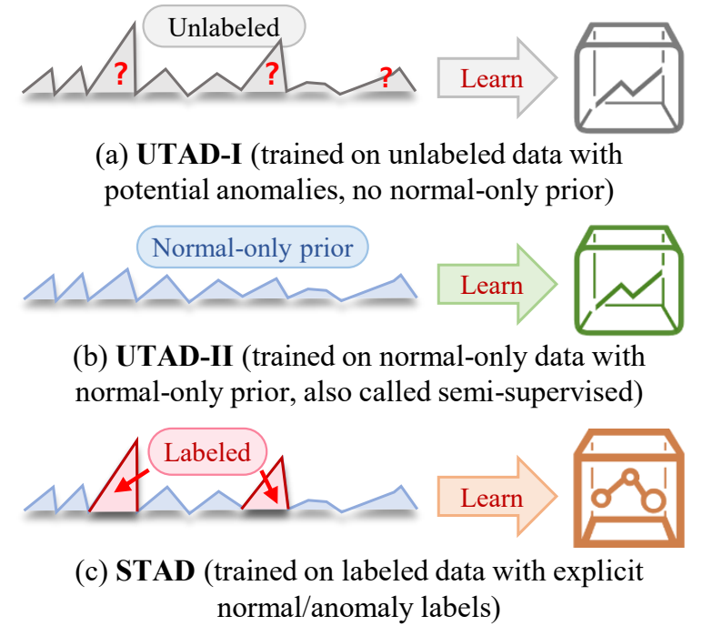
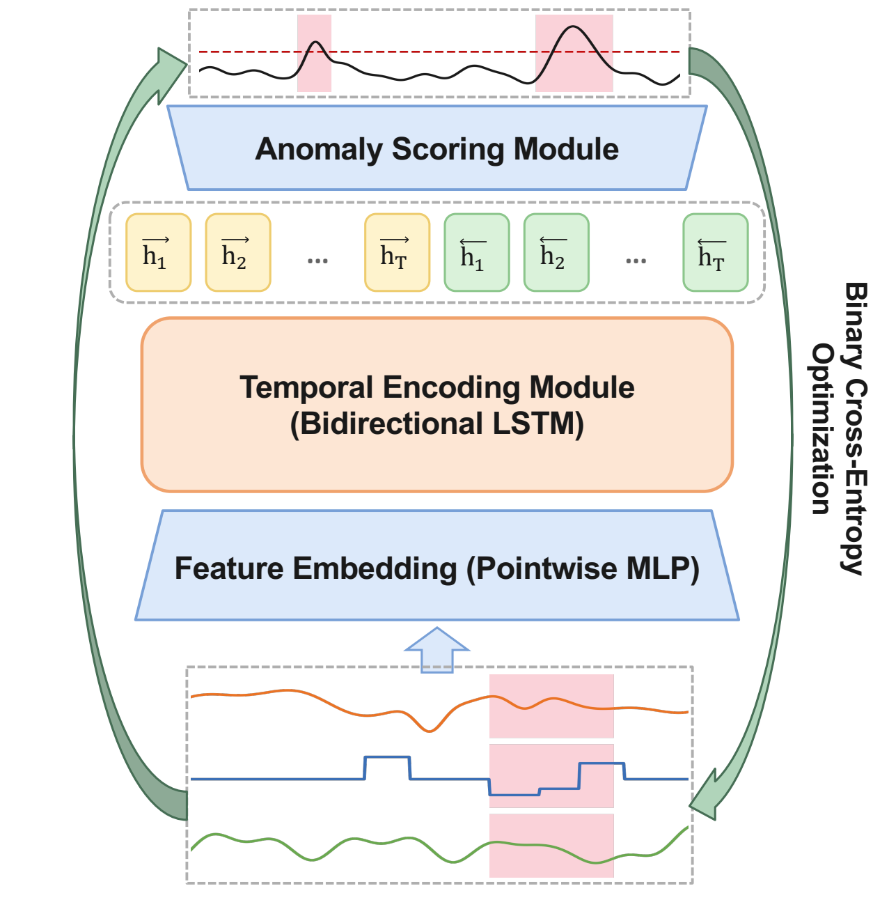
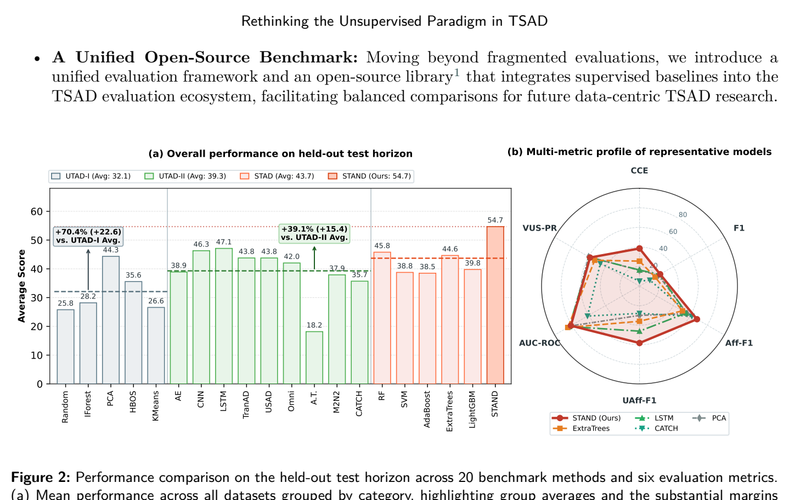
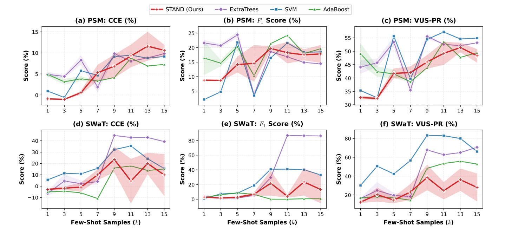
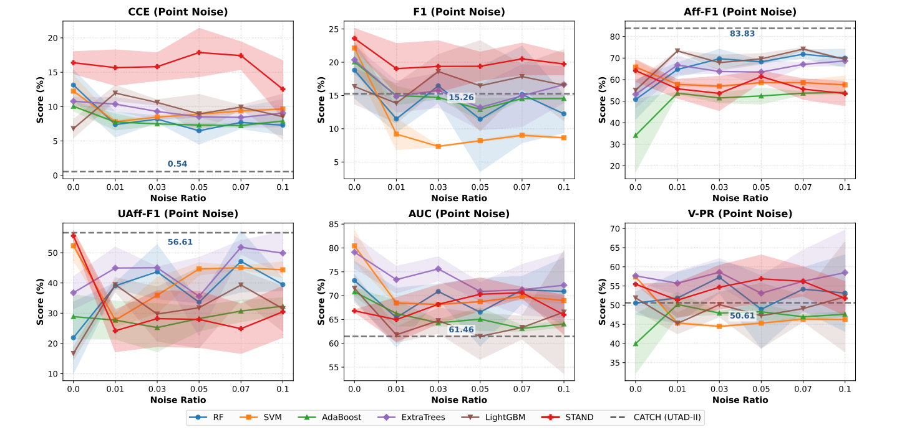
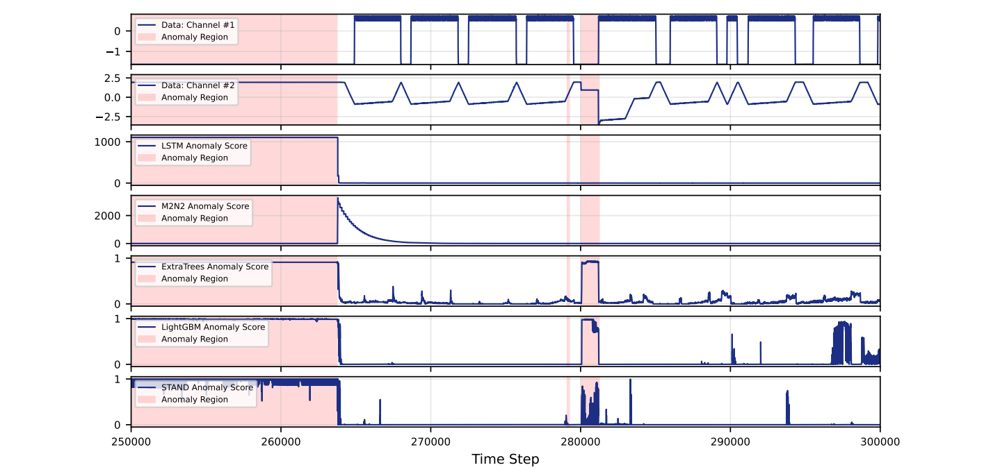

# Rethinking the Unsupervised Paradigm in Time Series Anomaly Detection: An Empirical Study and Minimalist Baseline

<div align="center">

[](https://www.sciencedirect.com/journal/information-sciences)
[](https://arxiv.org/abs/2511.16145)
[](https://emorzz1g.github.io/STAND)
[](https://www.python.org/)
[](LICENSE)

**[Zhijie Zhong](https://scholar.google.com/citations?user=rn_Xd0kAAAAJ)**<sup>1,2</sup> &nbsp;|&nbsp;
**[Zhiwen Yu](https://www2.scut.edu.cn/cs/2017/0129/c22284a327666/page.psp)**<sup>2,1,*</sup> &nbsp;|&nbsp;
**Kaixiang Yang**<sup>2</sup> &nbsp;|&nbsp;
**Yongheng Liu**<sup>1</sup> &nbsp;|&nbsp;
**Jun Jiang**<sup>1</sup> &nbsp;|&nbsp;
**C. L. Philip Chen**<sup>2</sup>

<sup>1</sup> Peng Cheng Laboratory, Shenzhen, China &nbsp;&nbsp;&nbsp;
<sup>2</sup> South China University of Technology, Guangzhou, China  
<sup>*</sup> Corresponding Author: `zhwyu@scut.edu.cn`

</div>

---

## 📢 News

- **[2026.03]** 🎉 Our paper has been **Accepted for publication in *Information Sciences*** (Elsevier)!
- **[2026.03]** 📄 The arXiv preprint has been updated to version **[arXiv:2511.16145](https://arxiv.org/abs/2511.16145)** with the new title, theoretical insights, and extended benchmarks.
- **[2026.03]** 🌐 Interactive project page and benchmark resources are publicly hosted at **[https://emorzz1g.github.io/STAND](https://emorzz1g.github.io/STAND)**.

---

## 💡 Overview & Motivation

In time series anomaly detection (TSAD), the prevailing research paradigm predominantly pursues **unsupervised architectures** (Transformers, state-space Mamba models, generative diffusion, and LLM-guided frameworks) to map normal operational dynamics under an assumed absence of annotations.

However, in actual industrial cyber-physical systems, data centers, and critical infrastructures, **sparse collections of verified failure events are naturally archived** through SCADA emergency trips, post-incident root-cause analysis (RCA) records, and routine scheduled maintenance logs at near-zero extra cost.

This motivates us to revisit two fundamental questions:
1. *In operational deployments with limited historical annotations, how does the marginal gain from model complexity compare to that from sparse supervisory signals?*
2. *Can a deliberately minimalist supervised baseline provide an informative reference point for evaluating anomaly detection paradigms?*

<p align="center">
  
  <br>
  <em>Figure 1: Classification of time series anomaly detection approaches: (a) UTAD-I (mixed unlabeled streams), (b) UTAD-II (nominal clean-data prior), and (c) STAD (explicit discriminative supervision).</em>
</p>

To address these questions, we introduce **STAND** (**S**upervised **T**ime-series **AN**omaly **D**etection), a deliberately minimalist supervised baseline that strips away self-attention, generative, and diffusion mechanisms, isolating the empirical returns of supervisory signals.

---

## 🏛️ The STAND Framework

STAND is designed with simplicity, stability, and extreme computational efficiency in mind:

<p align="center">
  
  <br>
  <em>Figure 2: Overall architecture of the STAND framework.</em>
</p>

1. **Feature Embedding**: A pointwise Multi-Layer Perceptron (Pointwise MLP + GELU activations + Layer Normalization) projects raw multivariate inputs $\mathbf{x}_t \in \mathbb{R}^C$ into a $d_{\text{model}}$-dimensional latent space.
2. **Temporal Encoding Module (TEM)**:
   - **Default (STAND)**: A shallow Bidirectional LSTM (1–2 layers) captures rich temporal context from both anomaly onset and subsequent post-incident recovery patterns for offline auditing.
   - **Streaming (STAND-Causal)**: A unidirectional causal forward-only LSTM variant with zero look-ahead buffering delay for real-time online telemetry monitoring.
3. **Anomaly Scoring Module & Objective**: A linear projection maps hidden states to scalar anomaly logits, optimized end-to-end via timestamp-level Binary Cross-Entropy (BCE) loss without cumbersome hyperparameter reweighting.

---

## 🔬 Key Empirical Discoveries

<p align="center">
  
  <br>
  <em>Figure 3: (a) Overall held-out performance across 20 benchmark methods and 5 datasets. (b) Multi-metric capability profile of top-tier methods.</em>
</p>

### 1. Supervision Outperforms Unsupervised Architectural Scaling
- Under a strictly disjoint out-of-sample temporal protocol across 5 benchmarks (PSM, SWaT, WADI, Swan, Water), STAND attains an overall mean score of **54.7**, surpassing the **UTAD-I category average by +70.4% (+22.6)** and the **UTAD-II category average by +39.1% (+15.4)**.
- In multi-metric evaluations, STAND demonstrates marked superiority in **prediction certainty (CCE: 38.50 vs. <17.55 for all unsupervised detectors)** and **unbiased event localization (UAff-F1: 58.22 vs. LSTM 46.09, CATCH 27.88)**.
- Across all 30 dataset-metric evaluation settings, non-parametric ranking confirms STAND achieves the **top overall average rank of 5.70**, surpassing all 20 evaluated models.

### 2. Acute Few-Shot Efficiency ($k = 5 \sim 7$ Break-Even Point)
<p align="center">
  
  <br>
  <em>Figure 4: Event-level few-shot label efficiency across varying numbers of observed failure episodes ($k \in \{1, 3, \dots, 15\}$) on PSM and SWaT.</em>
</p>

- On PSM (subset SP1), observing as few as **12 failure episodes** (only 10% data volume, with 83.3% of test failure events never seen in training) allows STAND to outperform deep unsupervised baselines.
- Controlled event-level scaling demonstrates a decisive break-even point at **$k = 5 \sim 7$ discrete episodes**, after which STAND rapidly outpaces unsupervised counterparts.

### 3. Resilience to Operational Label Noise
<p align="center">
  
  <br>
  <em>Figure 5: Robustness of supervised detectors against random Point Noise up to $\rho = 0.10$ on PSM, with unsupervised CATCH as a baseline.</em>
</p>

- STAND maintains remarkable robustness under point label corruption (up to 10%) and contiguous block noise; sequential recurrent modeling acts as an inductive temporal smoother, preventing overfitting to isolated misannotations.

### 4. Matched Backbone Cross-Paradigm Validation
By comparing identical sequential backbones trained under unsupervised reconstruction (MSE) versus supervised discrimination (BCE):
- BCE supervision delivers a net surge of **+37.37 in CCE, +36.25 in UAff-F1, and +19.70 in AUC-ROC**, directly confirming that the primary bottleneck stems from the **unsupervised surrogate proxy loss**, not sequence encoder capacity.

### 5. Minimalist Footprint & High Industrial Throughput
| Model | Paradigm | Params (M) | Peak VRAM (MB) | Infer. Latency ($\mu$s) | Throughput ($10^3$ pts/s) |
| :--- | :--- | :---: | :---: | :---: | :---: |
| **Anomaly Transformer** | UTAD-II (GPU) | 4.80 | 5497.1 | 240.0 | 4.2 |
| **CATCH** | UTAD-II (GPU) | 89.86 | 2231.7 | 7.6 | 132.0 |
| **ExtraTrees** | STAD (CPU) | — | <200 MB RAM | 1.3 | 798.1 |
| **STAND (Ours)** | **STAD (GPU)** | **0.04** | **86.5** | **8.8** | **113.7** |

*STAND requires **<87 MB VRAM** (>96% reduction vs. CATCH, >98% reduction vs. Anomaly Transformer) and executes **>27× faster** than Anomaly Transformer, rendering it ideal for edge gateways and high-frequency streaming.*

---

## 📂 Repository Structure

```
STAND/
├── src/
│   ├── data_utils/        # Dataset loading, temporal chunking & normalization
│   ├── exp/               # Experiment entrypoints (supervised, unsupervised, semisupervised)
│   ├── models/            # Model definitions
│   │   ├── supervised/    # STAND, STAND-Causal, RF, ExtraTrees, LightGBM, etc.
│   │   └── unsupervised/  # AE, CNN, LSTM, TranAD, USAD, Omni, CATCH, etc.
│   ├── scripts/           # Batch execution scripts for all benchmark datasets
│   └── utils/             # Evaluation metrics (CCE, Aff-F1, UAff-F1, VUS, etc.)
├── logs/                  # Training logs, checkpoints, and post-analysis figures
├── docs/                  # Interactive project website files (GitHub Pages)
│   ├── static/            # Images, PDFs, and modern CSS/JS styles
│   └── index.html         # Project homepage
├── requirements.txt       # Project dependencies
└── README.md              # Project documentation
```

---

## 🛠️ Installation

```bash
# Clone the repository
git clone https://github.com/EmorZz1G/STAND.git
cd STAND

# Create a virtual environment
python -m venv venv
source venv/bin/activate  # Windows: venv\Scripts\activate

# Install required packages
pip install -r requirements.txt
```

---

## 🚀 Quick Start

### 1. Download Datasets
The benchmark suite evaluates five real-world multivariate datasets: **PSM**, **SWaT**, **WADI**, **Swan**, and **Water**. Preprocessed benchmark sequences can be accessed following the [TSB-UAD](https://github.com/TheDatumOrg/TSB-AD) or [FTSAD](https://github.com/EmorZz1G/FTSAD) repositories. Place the dataset files into the `data/` directory.

### 2. Run Supervised Benchmark (STAND & Baselines)
```bash
# Train and evaluate STAND on a specific dataset (e.g., PSM)
cd src/exp
python supervised.py --model_name STAND --dataset_name PSM --d_model 128 --num_layers 1 --win_size 32

# Run all supervised baselines across all datasets
cd ../scripts
bash run_supervised.sh  # or: python run_supervised.py
```

### 3. Run Few-Shot & Label Scaling Experiments
```bash
# Evaluate label scaling on PSM subsets (SP1, SP2, SP3)
python supervised.py --model_name STAND --dataset_name PSM_SP1
```

### 4. Run Unsupervised Baselines
```bash
cd src/scripts
python run_unsupervised.py
```

---

## 📊 Qualitative Detection Localization

<p align="center">
  
  <br>
  <em>Figure 6: Anomaly score trajectories on an unobserved test segment of SWaT (timestamps 250k–300k). STAND immediately responds to failure onset and sharply recovers at incident termination, whereas unsupervised baselines exhibit diffuse boundaries and severe lag.</em>
</p>

---

## 📖 Citation

If you find this research or code useful in your work, please consider citing our paper:

```bibtex
@article{zhong2026rethinking,
  title={Rethinking the Unsupervised Paradigm in Time Series Anomaly Detection: An Empirical Study and Minimalist Baseline},
  author={Zhong, Zhijie and Yu, Zhiwen and Yang, Kaixiang and Liu, Yongheng and Jiang, Jun and Chen, C. L. Philip},
  journal={Information Sciences},
  year={2026},
  note={Accepted for publication},
  archivePrefix={arXiv},
  eprint={2511.16145},
  primaryClass={cs.LG},
  url={https://arxiv.org/abs/2511.16145}
}
```

---

## 📄 License

This project is licensed under the [MIT License](LICENSE).